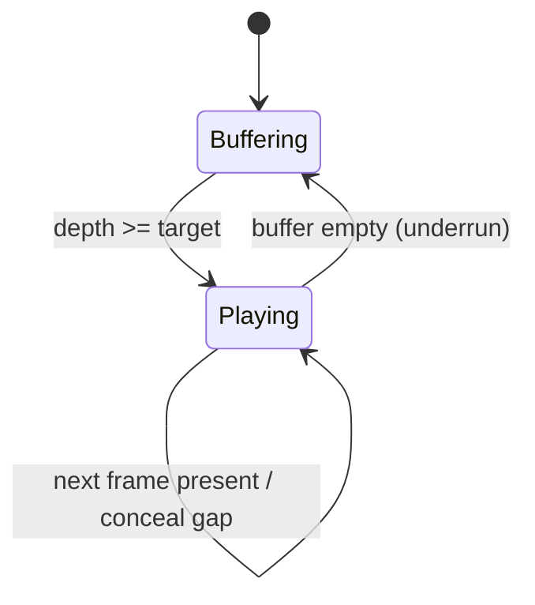
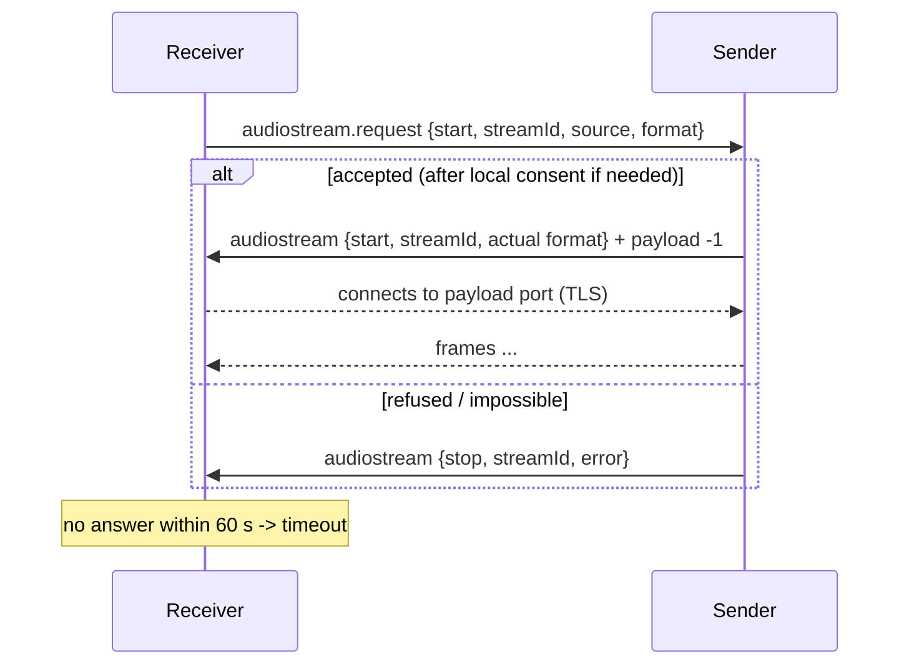
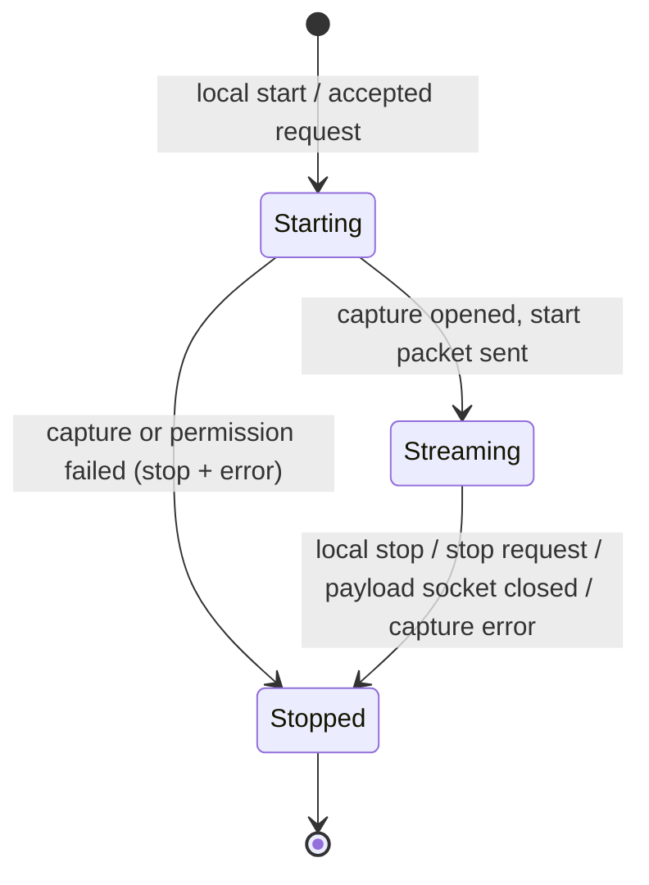

# Audio streaming (`audiostream`)

Status: implemented in kdeconnect-kde (`plugins/audiostream`, plugin id `kdeconnect_audiostream`)
and kdeconnect-android (`plugins/audiostream`, plugin key `AudioStreamPlugin`).
This file is identical in both repositories.

## Goals

- Stream live audio between any two paired devices: desktop -> desktop, desktop -> Android,
  Android -> desktop, Android -> Android.
- Sources: `media` (what is playing), `system` (whole output mix), `call` (call audio) and
  `microphone`.
- Both directions can be initiated from either end: a device can *push* its own audio to a peer,
  or *request* (pull) audio from a peer.
- Several concurrent streams per device pair, in both directions.
- Bounded latency: a jitter buffer with a latency target, a drop policy instead of unbounded
  queues, and measurable delay.
- Reuse the existing TLS payload channel; no new sockets, ports or crypto.
- Be the single audio transport used by other features (call handoff requests `source:"call"`).

## Non-goals

- Media controls (play/pause/seek/metadata): already provided by the mpris plugins.
- Lossy compression: only uncompressed PCM is implemented (see "Codecs").
- Echo cancellation, mixing several remote streams into one, synchronised multi-room playback.
- Capturing audio the operating system does not let a regular app capture (see "Platform
  limitations").
- Relaying through the Bluetooth backend is not a target (see "Transport").

## Packet types

| Packet type | Sent by | Purpose |
|---|---|---|
| `kdeconnect.audiostream` | the audio **sender** | stream offer carrying the endless payload (`start`), end of stream (`stop`), capability report (`capabilities`) |
| `kdeconnect.audiostream.request` | the audio **receiver** (or anyone asking) | ask the peer to start or stop sending, reject/stop an incoming stream, query capabilities |

Both packet types are listed as supported and outgoing by both implementations, so the plugin is
loaded whenever both devices have it.

### Common fields

| Field | Type | Notes |
|---|---|---|
| `action` | string | `"start"`, `"stop"` or `"capabilities"`. Required in every packet. |
| `streamId` | string | Required for `start` and `stop`. Chosen by whoever creates the stream (the requester for pulled streams, the sender for pushed streams). 1..64 chars of `[A-Za-z0-9._:-]`. Unique per device pair while the stream exists. |
| `source` | string | `"media"`, `"system"`, `"call"` or `"microphone"`. Required for `start`. |
| `codec` | string | `"pcm_s16le"` (mandatory baseline). `"opus"` is a reserved value; no implementation advertises or accepts it yet. Required for `start`. |
| `sampleRate` | int | Hz, 8000..96000. Every implementation must accept 48000. Required for `start`. |
| `channels` | int | 1 or 2. Required for `start`. |

`stop` and `capabilities` packets should carry the same fields when known; receivers must not
require them.

### `kdeconnect.audiostream.request`

Start request (ask the peer to send its audio here):

```json
{
  "id": 1761600000000,
  "type": "kdeconnect.audiostream.request",
  "body": {
    "action": "start",
    "streamId": "4f1c3a52-8b8e-4c55-9d0a-6a3f9f7f2b10",
    "source": "media",
    "codec": "pcm_s16le",
    "sampleRate": 48000,
    "channels": 2
  }
}
```

The format fields are preferences. The sender may pick a different supported format (for
example mono for a microphone) and states the actual format in its `start` packet, which is
authoritative.

Stop request (receiver stops or rejects a stream, or withdraws a pending request):

```json
{ "type": "kdeconnect.audiostream.request",
  "body": { "action": "stop", "streamId": "4f1c3a52-...", "error": "playback_failed" } }
```

`error` is optional; absent means a normal user stop.

Capability query:

```json
{ "type": "kdeconnect.audiostream.request", "body": { "action": "capabilities" } }
```

### `kdeconnect.audiostream`

Stream start, with the endless payload:

```json
{
  "id": 1761600000123,
  "type": "kdeconnect.audiostream",
  "body": {
    "action": "start",
    "streamId": "4f1c3a52-8b8e-4c55-9d0a-6a3f9f7f2b10",
    "source": "media",
    "codec": "pcm_s16le",
    "sampleRate": 48000,
    "channels": 2,
    "frameDurationMs": 20
  },
  "payloadSize": -1,
  "payloadTransferInfo": { "port": 1739 }
}
```

- `frameDurationMs` (int, 5..100): nominal duration of one frame. Used to size the jitter buffer.
- `callAudio` (string, only with `source:"call"`): `"full"` when both the local microphone and
  the remote party are captured (desktop), `"local_microphone_only"` when only the local
  microphone could be captured (Android, see limitations).

Stream stop (sent by the sender when a stream ends for any reason, also as a reply to a request
it cannot honour):

```json
{ "type": "kdeconnect.audiostream",
  "body": { "action": "stop", "streamId": "4f1c3a52-...", "source": "media", "error": "permission_denied" } }
```

Capabilities report (reply to a capability query; also sent unprompted once when the link comes
up):

```json
{
  "type": "kdeconnect.audiostream",
  "body": {
    "action": "capabilities",
    "protocolVersion": 1,
    "sources": ["media", "system", "call", "microphone"],
    "codecs": ["pcm_s16le"],
    "sampleRates": [48000],
    "canPlay": true,
    "maxStreams": 4
  }
}
```

- `sources`: sources this device can capture on this platform/OS version (not a promise that
  the user will grant permission).
- `canPlay`: whether this device can play streams.
- `maxStreams`: limit of concurrent streams (both directions together) with one peer.

### Error codes

| `error` | Meaning |
|---|---|
| `unsupported_source` | the source cannot be captured on this device/OS |
| `unsupported_format` | no common codec/format |
| `permission_denied` | the local user or the OS refused (consent dialog, runtime permission, confirmation prompt) |
| `busy` | `maxStreams` reached or `streamId` already in use |
| `capture_failed` | the capture device could not be opened or failed while streaming |
| `silenced` | the sender's OS mutes the capture, for example Android during a cellular call; the receiver should tell the user rather than end silently |
| `playback_failed` | the receiver could not open an output device |
| `timeout` | a request was not answered in time |
| `invalid_request` | malformed packet (missing/invalid field) |

Unknown error codes must be treated as a generic failure.

## Transport

The `start` packet carries an endless payload (`payloadSize: -1`) over the existing payload
channel: the sender opens a payload port (1739-1764), announces it in `payloadTransferInfo`, the
receiver connects and both sides run TLS with the paired certificates, exactly like file
transfers. One TCP/TLS connection per stream.

Changes made to the payload code so it supports unbounded live streams:

- Desktop `UploadJob` (LAN): for an endless payload (`payloadSize -1`) coming from a sequential
  device, running out of buffered data no longer ends the transfer; the job waits for
  `readyRead` and continues. The transfer ends when the source device is closed. When the
  receiver disconnects, the source device is closed so its owner learns the stream ended.
  Finite payloads, and `-1` payloads from non-sequential devices (files of unknown size), keep the
  previous behaviour.
- Desktop `BluetoothUploadJob`: same rule for sequential endless sources.
- Android `LanLink`: the receiving payload socket of an endless payload gets no read timeout
  (the default 10 s timeout would kill a paused stream). Sending already streamed until EOF.

### Framing

The payload is a sequence of frames. All integers are big endian.

| Offset | Size | Field |
|---|---|---|
| 0 | 2 | magic `0x4B 0x41` (`"KA"`) |
| 2 | 1 | version, `1` |
| 3 | 1 | flags; bit 0 = last frame of the stream, other bits reserved (0) |
| 4 | 4 | sequence number, u32, +1 per frame, wraps |
| 8 | 8 | timestamp, u64, microseconds of the sender's monotonic clock at capture of the first sample |
| 16 | 4 | data length `N`, u32, 0..65536 |
| 20 | N | codec data; for `pcm_s16le` interleaved signed 16-bit little-endian samples |

A 20 ms stereo 48 kHz frame is 3840 bytes of data (3860 on the wire, ~193 kB/s).

Resynchronisation: if the decoder reads a header with a wrong magic, an unknown version or a
length above 65536, it discards one byte and scans for the next valid header. Over TLS this only
protects against implementation bugs, but it keeps a receiver from wedging on garbage.

Sequence numbers let the receiver detect frames the sender dropped. Timestamps let it measure
delay: `delay = arrival - timestamp` mixes the unknown clock offset with network delay, so the
receiver tracks the minimum observed `delay` and reports `delay - minimum` as the current
network jitter/queueing delay.

### Jitter buffer and latency target

The receiver keeps frames in a buffer indexed by (unwrapped) sequence number.

- Target depth = `ceil(latencyMs / frameDurationMs)` frames, default `latencyMs` = 80
  (desktop) / 100 (Android). Maximum depth = target + `ceil(200 / frameDurationMs)`.
- States: `Buffering` (prefilling) and `Playing`.
- `push`: frames older than the next one to play are dropped as *late*; duplicates are dropped;
  if the buffer exceeds the maximum depth the oldest frames are dropped until it is back at the
  target (*overflow*; this also absorbs clock drift where the sender is faster).
- `pop` (driven by the audio output clock):
  - `Buffering`: returns nothing (output plays silence) until the depth reaches the target, then
    switches to `Playing` starting at the oldest frame.
  - `Playing`: returns the next frame if present; if it is missing but later frames are
    buffered it is counted as *lost* and replaced by silence of the same length (concealment); if
    the buffer is empty it is an *underrun*: back to `Buffering`.



### Backpressure and drop policy

The sender never blocks capture. Encoded frames go to a bounded queue (default 250 ms). If the
network does not drain it, the oldest frames that have not started being written are dropped and
counted; their sequence numbers are skipped, so the receiver sees them as lost. This keeps
latency bounded instead of growing a backlog. TCP flow control does the rest.

### Clock drift

Sender and receiver clocks differ slightly. A faster sender grows the buffer until the overflow
rule trims it; a slower sender eventually underruns and rebuffers. No resampling is done.

## State machines

### Pulled stream (receiver asks)



Requester side: `Idle -> Requested -> Playing -> Stopped`, with `Requested -> Stopped` on a
`stop` reply or the 60 s timeout (Android waits for a user tap on a consent notification, hence the
long timeout).

### Pushed stream (sender offers)

The sender sends `audiostream {start}` with the payload directly. The receiver plays it, or
rejects it with `audiostream.request {stop, streamId, error}` and closes the payload.

### Sender session



### Teardown

- The side that stops first sends its stop packet (`audiostream {stop}` from the sender,
  `audiostream.request {stop}` from the receiver) and closes its end of the payload connection.
- The other side treats either the stop packet or the payload connection closing as the end of
  the stream. Both are idempotent; a sender also answers a stop request with `audiostream {stop}`.
- Unpairing, disconnection, or unloading the plugin stops every stream with that device.

### Multiple streams

Streams are independent: each has its own `streamId`, payload connection, capture or playback
pipeline and jitter buffer. Each implementation limits a device pair to `maxStreams` (4) active
or pending streams; extra requests get `busy`. Several incoming streams are mixed by the local
sound server (each gets its own output stream).

## Capability negotiation

1. Packet-type level: the plugin is only loaded when the peer advertises the packet types
   (standard KDE Connect identity capabilities). Other features (call handoff) check that the peer
   supports `kdeconnect.audiostream.request` before offering to move audio.
2. When the link comes up each side sends `audiostream.request {capabilities}`; the reply lists
   capturable sources, codecs, playback ability and the stream limit. UIs only offer sources the
   peer reports.
3. Format: a requester states its preferred format. The sender keeps it when it can, otherwise
   falls back to `pcm_s16le`, 48000 Hz and the channel count of the source. The receiver accepts any
   `pcm_s16le` stream within the field ranges and refuses anything else with
   `unsupported_format`.

## Codecs

- `pcm_s16le` is the only implemented codec. At 48 kHz stereo this is about 1.5 Mbit/s, fine on a
  LAN.
- Opus was not implemented: Android only ships an Opus *encoder* in MediaCodec from API 29 and
  with device-dependent availability, and the desktop would need a new libopus dependency plus
  packet-loss concealment. The value `"opus"` is reserved so it can be negotiated later without a
  protocol change; today neither side advertises it.

## Security considerations

- Audio only travels over the TLS payload channel authenticated with the paired certificates;
  packets from unpaired devices never reach plugins.
- Capturing audio on request of a remote device is privacy sensitive:
  - Desktop: remote requests for `microphone` and `call` show a notification asking the local
    user to allow or deny; no answer within 30 s denies (`permission_denied`). `media`/`system`
    requests are served without a prompt, like the mpris plugin exposes what is playing; the
    user always sees a notification while a stream is being sent.
  - Android: every remote capture request needs a tap on a notification, followed by the OS
    consent (runtime microphone permission and/or the MediaProjection dialog). Android shows its
    own capture indicators. One exception: when the user answers a call from the peer with
    `audioRoute: "remote"` (see `callhandoff.md`), that answer is the consent for the one `call`
    request that follows within 30 s. The approval is single-use and is cleared when the call
    ends. If Android refuses to start the capture from the background, the normal consent
    notification is shown instead.
- An ongoing outgoing stream is always visible (desktop notification, Android foreground
  service notification) and can be stopped from there.
- Resource limits: `maxStreams` per device, frames above 64 KiB rejected, bounded sender queue
  and jitter buffer, so a peer cannot make the receiver allocate without bound.
- Nothing is written to disk.

## Platform limitations

### Desktop (Linux)

- Capture uses libpulse (`pa_simple`), which works with PulseAudio and with PipeWire through
  `pipewire-pulse`. Qt Multimedia's `QAudioSource` cannot be used for the monitor because Qt's
  device list does not expose sink monitor sources (checked with Qt 6.12, PulseAudio and
  PipeWire backends). Microphone capture uses the same API with the default source, so the
  plugin is built only when `WITH_PULSEAUDIO` is on (Linux). Playback uses `QAudioSink` on the
  default output.
- `media` and `system` are both the default sink monitor: there is no per-application
  separation, notifications and other sounds are included.
- `call` captures the default sink monitor (remote party of a softphone/VoIP call or a call
  routed through the desktop) mixed with the default microphone, `callAudio:"full"`. The two
  sources may drift if they are on different sound cards; PulseAudio then drops or pads.
- Capturing the monitor while also playing a stream from the same peer creates a feedback loop;
  this is the user's choice and is not prevented.
- Remote requests for `microphone` and `call` wait for the local user to press Allow on a
  notification. Inside the Flatpak, KNotification sends it through the desktop portal
  (`org.freedesktop.portal.Notification`), so a portal backend that implements notifications
  must be running (Plasma, GNOME and most desktops have one). Without it nothing is shown and
  the request is denied after 30 s. Verified in a test session: without a notification backend
  the request stayed `awaitingConfirmation`; with `xdg-desktop-portal-gtk` the prompt appeared
  and pressing Allow started the stream.
- Windows/macOS: not built (no capture backend implemented).

### Android

- `media`/`system` need Android 10 (API 29): `AudioPlaybackCaptureConfiguration` with a
  MediaProjection, which requires the user to accept the system screen/audio capture dialog for
  every stream (on Android 14+ the token is single-use) and a foreground service of type
  `mediaProjection`. On Android 14+ the dialog is opened with
  `MediaProjectionConfig.createConfigForDefaultDisplay()`: its default "A single app" would
  limit playback capture to that one app. `media` captures `USAGE_MEDIA`; `system` captures `USAGE_MEDIA`,
  `USAGE_GAME` and `USAGE_UNKNOWN`. Android does not allow capturing any other usage
  (notifications, alarms, voice calls, assistant...). Apps can opt out of capture
  (`allowAudioPlaybackCapture="false"`, and apps targeting API < 29 are opted out by default);
  their audio is silence in the stream. On Android 9 and older these sources are not reported.
- Playback capture only applies to players that start after the capture began. Audio that was
  already playing when the stream started stays on the phone and the stream carries silence
  until the app recreates its player (for example when the user starts the next track). Some
  apps, such as YouTube Music, also stop playback when the capture consent dialog opens. The
  user therefore has to start or restart playback after starting the stream. Verified on an
  Android 15 emulator: a tone started before the stream arrived as silence, the same tone
  started after it arrived at full level.
- `microphone`: `AudioRecord` with `MediaRecorder.AudioSource.MIC`, runtime permission
  `RECORD_AUDIO`, foreground service type `microphone`, mono.
- `call`: cellular call audio cannot be captured by third-party apps (`VOICE_CALL`,
  `VOICE_DOWNLINK`, `VOICE_UPLINK` require the privileged `CAPTURE_AUDIO_OUTPUT` permission).
  `call` therefore records `VOICE_COMMUNICATION` (the local microphone with echo cancellation)
  and the start packet says `callAudio:"local_microphone_only"`. The remote party's voice is never
  included. While a cellular call is active, Android's concurrent capture policy gives the
  microphone to the call and ordinary apps receive silence (only accessibility services and
  privileged system apps are exempt). The sender checks
  `AudioRecordingConfiguration.isClientSilenced()` twice a second (API 29+) and, after 2 s of
  continuous silencing, ends the stream with `error: "silenced"`; the desktop then tells the
  user why there is no call audio. On an Android 15 emulator the capture was silenced for the
  whole call (`src:VOICE_COMMUNICATION silenced` in `dumpsys audio`).
- Starting capture from a remote request: Android 10+ forbids starting activities, and Android
  14+ forbids starting microphone/mediaProjection foreground services, from the background
  ("Foreground service started from background can not have ... microphone access"). A remote
  request therefore posts a notification; the stream starts only after the user taps it and
  grants the permission/consent. Dismissing or denying replies `permission_denied`; not tapping
  within 60 s lets the requester time out. This also applies to the pre-approved call audio
  above: the approval removes the question, but on Android 14+ the capture still needs one tap
  on the notification to start.
- Playback: `AudioTrack` (`USAGE_MEDIA`). Incoming streams play inside a foreground service of
  type `mediaPlayback`. If Android refuses to start a foreground service at that moment
  (Android 12+ background start restrictions), playback still runs in the app process, which is
  kept alive by KDE Connect's own foreground service, and a regular notification with the stop
  button is shown instead.
- Only the LAN link is tested for streaming; Bluetooth links carry payloads through a
  multiplexed RFCOMM channel with far less bandwidth than PCM needs.

## UI surface

### Desktop

- D-Bus interface `org.kde.kdeconnect.device.audiostream` at
  `/modules/kdeconnect/devices/<id>/audiostream`:
  - `QString startStream(QString source)`: push local `source` to the device. Returns the
    `streamId`, empty on immediate failure.
  - `QString requestStream(QString source)`: ask the device to send its `source` here.
  - `void stopStream(QString streamId)`, `void stopAllStreams()`
  - `QStringList activeStreams()`: ids of active and pending streams.
  - `QVariantMap streamInfo(QString streamId)`: `direction` (`send`/`receive`), `state`,
    `source`, `codec`, `sampleRate`, `channels`, and counters (`framesSent`, `framesDropped`,
    `framesReceived`, `framesLost`, `framesLate`, `underruns`, `bufferedMs`, `jitterMs`).
  - `QStringList remoteSources()` (property): sources the peer reported.
  - Signals `streamStarted(QString streamId)`, `streamStopped(QString streamId, QString error)`.
- `kdeconnect-cli -d <id>`:
  - `--stream-audio <source>`: send local audio to the device.
  - `--request-audio <source>`: play the device's audio here.
  - `--stop-audio`: stop every stream with the device.
  - `--list-audio-streams`: list active streams.
- Notifications: incoming stream ("Playing audio from X", Stop action), outgoing stream
  ("Sending audio to X", Stop action), confirmation for remote microphone/call requests
  (Allow/Deny).

### Android

- Device menu entries: "Send audio to device" (pick a source) and "Play device audio here"
  (pick one of the sources the peer reported).
- Foreground service notification listing active streams with a "Stop" button.
- Request notification "X wants to receive your ... audio" with Allow/Deny.
- Permissions: `RECORD_AUDIO` (runtime), `POST_NOTIFICATIONS` (runtime, Android 13+),
  `FOREGROUND_SERVICE_MEDIA_PROJECTION`, `FOREGROUND_SERVICE_MICROPHONE`,
  `FOREGROUND_SERVICE_MEDIA_PLAYBACK`, plus the per-stream MediaProjection consent.

## Test plan

Automated (CI):

- Frame codec: encode/decode round trip, split delivery at every byte boundary, wrap-around of
  sequence numbers, rejection of oversized lengths, resynchronisation after garbage, last-frame
  flag.
- Jitter buffer: prefill to target, in-order playback, reordering within the buffer, loss
  concealment, late and duplicate frames, overflow trimming, underrun and rebuffering, sequence
  wrap-around.
- Sender queue: drop-oldest backpressure, partially read frames are never cut, close semantics.
- Protocol: parsing and validation of every action, defaults, rejection of invalid fields,
  format negotiation/fallback, capability packets, error codes.
- Desktop end to end: real `CompositeUploadJob`/`UploadJob` endless payload over a local TLS
  socket into the receiver pipeline: frames arrive complete and in order, the stream survives
  idle gaps, closing the sender ends the stream on the receiver, closing the receiver closes the
  sender's source device.
- Android end to end: sender queue -> local TCP socket -> decoder -> jitter buffer, including
  idle gaps and teardown.

Manual:

- Each direction (desktop/Android x desktop/Android) with each source; stop from either side;
  two concurrent streams; kill the network mid-stream; deny every permission/consent once.
