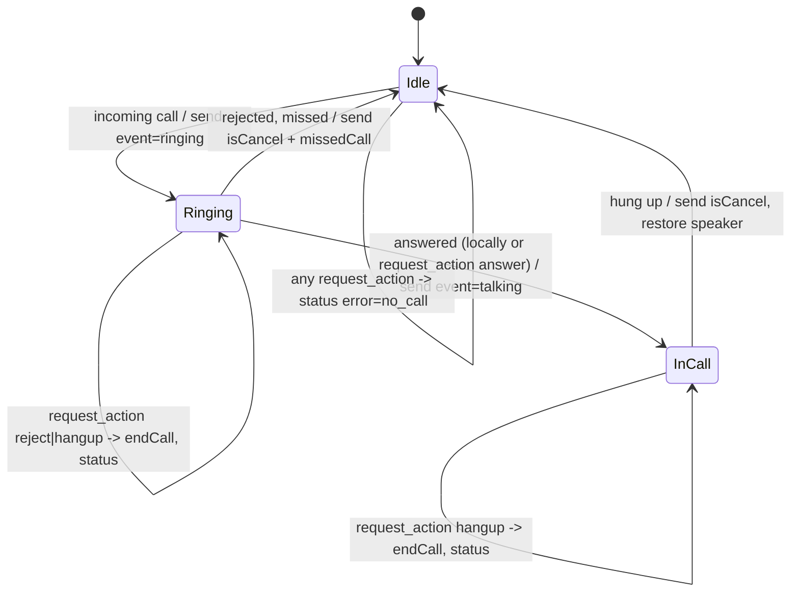
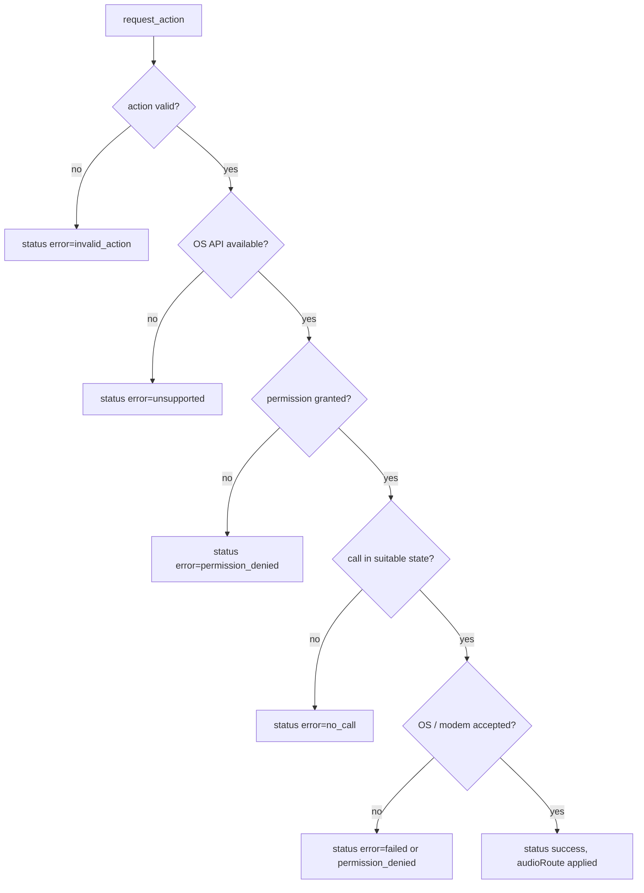
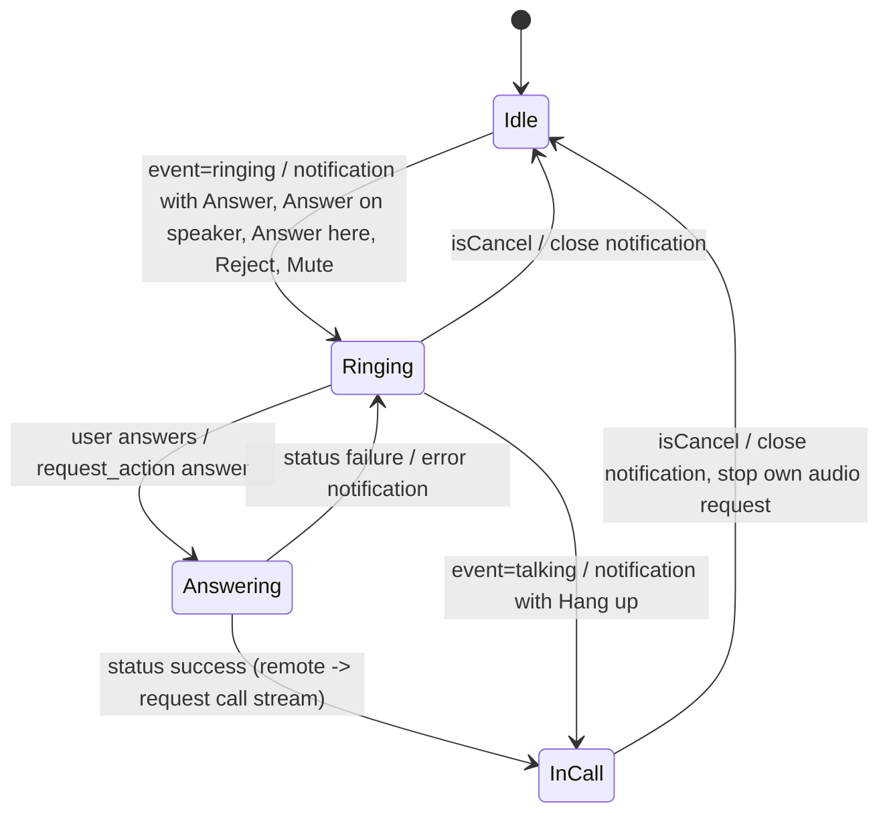

# Call handoff

Status: implemented in kdeconnect-kde (`plugins/telephony`, `plugins/mmtelephony`, `kdeconnect-cli`)
and kdeconnect-android (`plugins/telephony`). This file is identical in both repositories.

## Goals

- Answer, reject or hang up a call ringing on the Android phone from the desktop
  (notification actions, DBus, `kdeconnect-cli`).
- When answering from the desktop, let the user choose where the audio goes:
  the phone handset (`default`), the phone speaker (`speaker`) or the desktop (`remote`).
- Reverse direction: a call on a desktop modem (ModemManager, e.g. Linux phones or laptops
  with a WWAN modem) is announced on the Android phone with Answer / Reject / Hang up actions.
- Report failures back to the requesting side instead of silently ignoring them.
- Never transport audio in the telephony plugins: audio is only requested from the
  audiostream plugin (`kdeconnect.audiostream.request`), and only when the peer advertises it.

## Non-goals

- Placing outgoing calls, call waiting / hold / conference management, DTMF.
- Becoming the Android default dialer or an `InCallService` (see limitations).
- Implementing audio capture, transport or playback (owned by the audiostream feature).

## Roles

- Call holder: the device that owns the call (Android phone with a SIM, or a desktop with a
  ModemManager modem). It sends `kdeconnect.telephony` events, executes
  `kdeconnect.telephony.request_action` and answers with `kdeconnect.telephony.action_status`.
- Controller: the peer that shows the call and lets the user act on it. It sends
  `kdeconnect.telephony.request_action` and consumes `kdeconnect.telephony.action_status`.

| Implementation              | Holder | Controller |
|-----------------------------|--------|------------|
| Android `TelephonyPlugin`   | yes    | yes (for desktop modem calls) |
| Desktop `kdeconnect_telephony`   | no | yes (for phone calls) |
| Desktop `kdeconnect_mmtelephony` | yes (ModemManager calls) | no |

## Packets

### `kdeconnect.telephony` (existing, unchanged)

Sent by the holder. Fields: `event` (`ringing` | `talking` | `missedCall`), optional
`phoneNumber`, `contactName`, `phoneThumbnail` (base64 JPEG), `isCancel` (bool; the call
in the given state ended). Android now also accepts this packet (from `kdeconnect_mmtelephony`).

```json
{"type": "kdeconnect.telephony", "body": {"event": "ringing", "phoneNumber": "+15550100", "contactName": "Alice"}}
```

### `kdeconnect.telephony.request_action` (new)

Sent by the controller to the holder.

| Field         | Type   | Required | Meaning |
|---------------|--------|----------|---------|
| `action`      | string | yes      | `answer` \| `reject` \| `hangup` |
| `phoneNumber` | string | no       | Number of the call the user acted on. Used by the holder to pick the right call when it can tell calls apart (ModemManager); echoed in the status. |
| `audioRoute`  | string | no       | Only for `answer`: `default` (holder's normal routing, the default), `speaker` (holder's loudspeaker), `remote` (audio on the controller via audiostream). Unknown values are treated as `default`. |

```json
{"type": "kdeconnect.telephony.request_action", "body": {"action": "answer", "phoneNumber": "+15550100", "audioRoute": "remote"}}
```

Semantics:

- `answer`: accept the currently ringing incoming call.
- `reject`: decline the currently ringing incoming call.
- `hangup`: end the current call (ringing calls are declined, active calls are ended).

### `kdeconnect.telephony.action_status` (new)

Sent by the holder exactly once in reply to every `request_action`.

| Field         | Type   | Required | Meaning |
|---------------|--------|----------|---------|
| `action`      | string | yes      | Action of the request (`answer`, `reject`, `hangup`), or the raw value when invalid. |
| `success`     | bool   | yes      | Whether the holder executed the action. |
| `error`       | string | when `success` is false | `invalid_action`, `unsupported` (OS/API level cannot do it), `permission_denied`, `no_call` (no call in a suitable state), `failed` (the OS/modem refused). |
| `audioRoute`  | string | for successful `answer` | Route actually applied: `default`, `speaker` or `remote`. A `speaker` request the holder could not honour is reported as `default`. |
| `phoneNumber` | string | no       | Echo of the request field. |

```json
{"type": "kdeconnect.telephony.action_status", "body": {"action": "answer", "success": true, "audioRoute": "remote"}}
{"type": "kdeconnect.telephony.action_status", "body": {"action": "reject", "success": false, "error": "unsupported"}}
```

### Audio requests (`kdeconnect.audiostream.request`, owned by the audiostream feature)

The rule of the audiostream protocol is that the device that wants to hear a stream sends the
request to the device that produces it. Call handoff therefore only ever sends audio requests
from the controller, for `audioRoute` `remote` only, and only if the holder lists
`kdeconnect.audiostream.request` in its `incomingCapabilities`:

1. After a successful `action_status` for `answer` with `audioRoute: "remote"`, the controller
   requests the call audio from the holder (the holder reports `default` instead of `remote`
   when it cannot serve it, and then nothing is requested):
   ```json
   {"type": "kdeconnect.audiostream.request", "body": {"action": "start", "streamId": "call-<uuid>", "source": "call", "codec": "pcm_s16le", "sampleRate": 48000, "channels": 1}}
   ```
2. When the holder reports the end of the call (`kdeconnect.telephony` with `isCancel`), the
   controller stops the stream it requested:
   ```json
   {"type": "kdeconnect.audiostream.request", "body": {"action": "stop", "streamId": "call-<uuid>"}}
   ```

Desktop controller (phone call): `kdeconnect_telephony` sends these to the phone. Android
controller (desktop modem call): `TelephonyPlugin` sends these to the desktop.

Replies (`kdeconnect.audiostream` start/stop/error) and playback are handled entirely by the
audiostream plugin. If the holder lacks the capability, no audio request is sent and the
"audio here" option is not offered.

## Capability negotiation

- The controller only offers Answer / Reject / Hang up if the peer lists
  `kdeconnect.telephony.request_action` in its `incomingCapabilities`. Older peers get the old
  behaviour (desktop: only "Mute Call"; Android: an informational notification).
- The "audio here" option is only offered if the peer also lists
  `kdeconnect.audiostream.request` in its `incomingCapabilities`.
  Desktop DBus: `canAnswerCall()` / `canRouteAudioHere()`.
- Plugin metadata:
  - Desktop `kdeconnect_telephony`: supported `kdeconnect.telephony`,
    `kdeconnect.telephony.action_status`; outgoing `kdeconnect.telephony.request_mute`,
    `kdeconnect.telephony.request_action`, `kdeconnect.audiostream.request`.
  - Desktop `kdeconnect_mmtelephony`: supported `kdeconnect.telephony`,
    `kdeconnect.telephony.request_mute`, `kdeconnect.telephony.request_action`; outgoing
    `kdeconnect.telephony`, `kdeconnect.telephony.action_status`.
  - Android `TelephonyPlugin`: supported `kdeconnect.telephony`,
    `kdeconnect.telephony.request_mute`, `kdeconnect.telephony.request_action`,
    `kdeconnect.telephony.action_status`; outgoing `kdeconnect.telephony`,
    `kdeconnect.telephony.request_action`, `kdeconnect.telephony.action_status`,
    `kdeconnect.audiostream.request`.

## State machines

Holder (Android; ModemManager is equivalent with `RINGING_IN`/`WAITING` as ringing and
`ACTIVE`/`HELD`/`DIALING`/`RINGING_OUT` as in call):



Request handling on the holder:



Controller:



## Security considerations

- Packets are only processed from paired devices over the authenticated TLS link, like every
  other plugin. A paired device can already see call events; with this feature it can also
  answer or end calls, which a user can disable per device by disabling the telephony plugin.
- Android requires the user to grant `ANSWER_PHONE_CALLS` explicitly (runtime permission,
  requested through the plugin's optional permission dialog); without it every action fails
  with `permission_denied` and nothing happens on the phone.
- `phoneNumber` is never used to place calls; it is only used to choose between existing calls
  and is echoed back. Unknown `action` values are rejected with `invalid_action`.
- Remote audio is never started implicitly: it requires an explicit `answer` with
  `audioRoute: "remote"`, and the audiostream plugin applies its own permission checks.
- Emergency calls cannot be ended through `TelecomManager.endCall()` (enforced by Android).

## Platform limitations

Android:

- `TelecomManager.acceptRingingCall()` needs API 26 (Android 8.0) and `endCall()` needs API 28
  (Android 9). Older versions answer with `error: "unsupported"`. Both methods are deprecated
  since API 29 in favour of `InCallService`, which is only available to the default dialer or
  to apps holding the wearable companion role; KDE Connect is neither, so the deprecated APIs
  are the only option. They keep working on current Android versions for managed (carrier) calls,
  but self-managed VoIP calls (WhatsApp, Signal...) cannot be answered or ended by a
  third-party app.
- Speakerphone: an app that is not the dialer cannot reliably control in-call routing.
  The plugin uses `AudioManager.setCommunicationDevice()` (API 31+) or `setSpeakerphoneOn()`
  (older) right after answering; the dialer may override it. The status reports
  `audioRoute: "default"` when the speaker could not be selected.
- Call audio capture: Android does not allow third-party apps to capture the downlink of a
  cellular call (`VOICE_CALL`/`VOICE_DOWNLINK` sources require the privileged
  `CAPTURE_AUDIO_OUTPUT` permission), nor to inject audio into the uplink. For `remote` the phone
  therefore answers with the speaker enabled, and the audiostream plugin on Android serves the
  `call` source from the local microphone only (`callAudio: "local_microphone_only"`); while a
  cellular call is active many devices feed silence to non-privileged recorders. In practice
  `remote` on Android is a best-effort acoustic pickup of the phone speaker, may not carry the
  remote party's voice, and never carries the desktop user's voice into the call. A full audio
  handoff needs a Bluetooth HFP connection instead.
- Notifications for desktop modem calls need `POST_NOTIFICATIONS` on Android 13+; without it
  they are not shown (the actions are still available from nowhere else).

Desktop:

- Reverse direction requires a ModemManager modem with the Voice interface. ModemManager
  only provides call control; audio routing of the modem (ALSA/PipeWire, e.g. callaudiod on
  Linux phones) is outside its API. `speaker` is therefore reported as `default`, and `remote`
  only carries the call when the modem audio is routed through the desktop sound server (the
  desktop audiostream `call` source is sink monitor + default microphone). It is one-way: the
  Android user hears the call, but nothing feeds the phone microphone into the modem uplink.
- The desktop cannot answer calls on non-modem phones other than through this protocol;
  there is nothing to detect for regular desktops, so `kdeconnect_mmtelephony` stays the only
  desktop holder.

## UI surface

Desktop (`kdeconnect_telephony`):

- Ringing notification (`callReceived` event): Answer, Answer on speaker, Answer with audio
  here (only if the peer advertises audiostream), Reject, Mute Call. Old peers: only Mute Call.
- Talking notification (persistent, same event): "Call in progress with X" + Hang up.
- Failures (`action_status` with `success: false`): error notification with a readable reason.
- DBus (`org.kde.kdeconnect.device.telephony`): `bool answerCall(QString audioRoute)`,
  `bool rejectCall()`, `bool hangUp()`, `bool canAnswerCall()`, `bool canRouteAudioHere()`,
  `QStringList availableCallActions()`, `bool triggerCallAction(QString id)`,
  signal `callActionStatus(QString action, bool success, QString error)`.
- `kdeconnect-cli`: `--answer-call`, `--call-audio <default|speaker|remote>`, `--reject-call`,
  `--hang-up`.

Android (`TelephonyPlugin`):

- Optional permission `ANSWER_PHONE_CALLS` (API 26+) requested through the plugin settings
  dialog.
- For desktop modem calls: high priority notification "Incoming call on <device>" with
  Answer (audio stays on the desktop), Answer here (`remote`, only if the desktop advertises
  audiostream) and Reject; while talking: "Call in progress on <device>" with Hang up.
  Failures are shown as a notification.

## Test plan

Automated (CI):

- Desktop `tests/telephonytest.cpp` (QtTest, `TestDaemon` + `TestDevice` with injected peer
  capabilities): `request_action` fields for answer/reject/hangup and the phone number of the
  ringing call; offered actions per call state (`availableCallActions` / `triggerCallAction`,
  which back the notification actions); gating when the peer lacks `request_action`; invalid
  audio route; status
  handling (`callActionStatus` signal); `audioRoute: "remote"` success sends
  `kdeconnect.audiostream.request` start with `source: "call"` only when the peer advertises it;
  call end sends the matching stop; ModemManager call selection (`callselection.h`);
  `kdeconnect_mmtelephony` answers a `request_action` with `no_call` when no modem call exists
  and with `invalid_action` for garbage.
- Android `TelephonyCallHandoffTest` (JUnit + robolectric + mockk with a fake `CallController`):
  request parsing, API-level gating (25/26/27/28), permission gating, call state gating,
  `SecurityException` mapping, speaker fallback, audio-request decision from peer
  capabilities, and the plugin round trip (request in, status and audio request out,
  stop on idle).

Manual:

- Android 9+ phone + Plasma desktop: ring the phone, use each notification action and the
  cli options; verify status errors after revoking `ANSWER_PHONE_CALLS`.
- Linux phone with ModemManager + Android: ring the modem, answer/reject from the Android
  notification.
