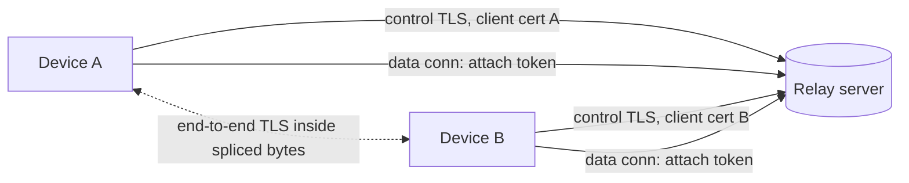
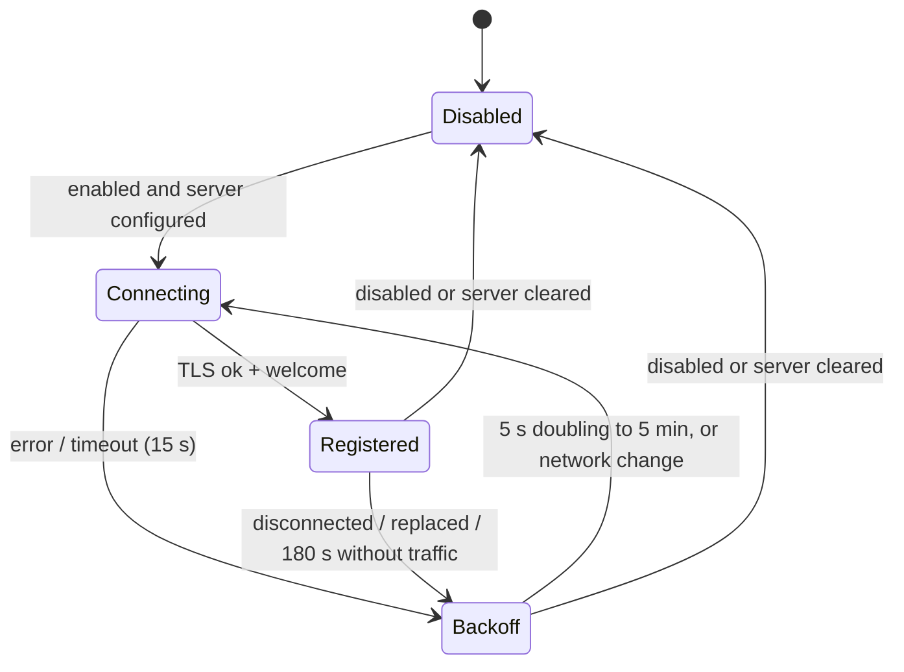
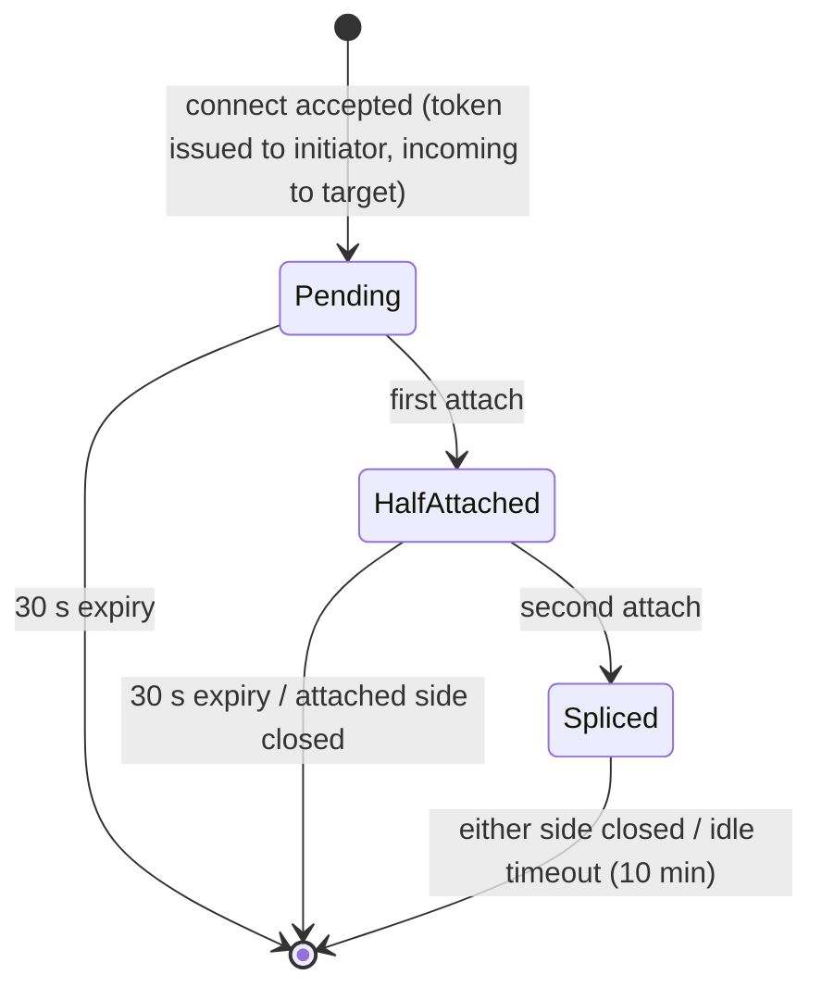
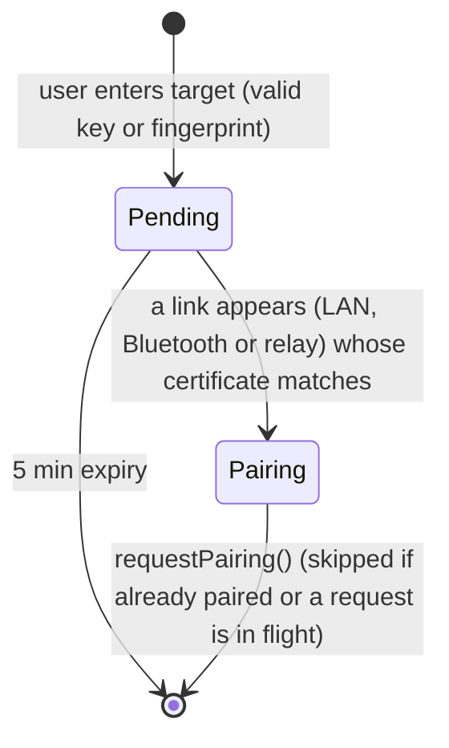

# KDE Connect relay and connect-by-key/fingerprint

Status: implemented in kdeconnect-kde (`core/backends/relay`, `relayserver/`) and
kdeconnect-android (`backends/relay`). This file is identical in both repositories.

## Goals

- Let two devices that are not on the same LAN connect through a user-configured relay server.
- The relay gives every connected device a short, human-friendly *relay key* derived from its
  public key. Another device types that key to connect. After the connection is set up, the
  normal KDE Connect identity exchange, `PairingHandler` flow and verification key comparison run
  unchanged.
- Alternatively, a device can type the other device's certificate SHA-256 fingerprint (or relay
  key) to connect and request pairing, both on the same LAN and on the same relay.
- The relay only ever forwards ciphertext of an end-to-end TLS session between the two devices.
  Both ends pin the expected peer certificate.
- Payloads (files, endless streams such as `kdeconnect.audiostream`) work over the relay.
- The relay server is a standalone Qt6 (QtCore + QtNetwork) daemon with rate limiting, connection
  and tunnel limits, idle timeouts and no persistent state besides its own TLS certificate/key.

## Non-goals

- NAT traversal / hole punching. All relayed traffic flows through the relay server.
- Federation between relay servers, accounts, or user directories. Devices must use the same
  relay server and know the peer's key or fingerprint.
- Discovery of arbitrary devices on the relay. There is no listing of online devices.
- Hiding metadata from the relay operator (who talks to whom, when, how much).

## Terminology

- *Fingerprint*: SHA-256 over the DER encoding of the device's X.509 certificate, written as 64
  lowercase hex characters. Input may contain `:`/spaces and any case. This is the value shown by
  "Encryption info" on both platforms.
- *Relay key*: first 100 bits of SHA-256 over the DER `SubjectPublicKeyInfo` of the device
  certificate's public key, encoded with the RFC 4648 base32 alphabet (`A-Z2-7`), 20 characters,
  shown in 5 groups of 4 separated by `-`. Input is case-insensitive; `-`, spaces and `=` are
  ignored. Example: `ULJO-GBWQ-G4X3-LFX5-N5SH`.
- *Target*: what the user types: a relay key (20 base32 chars after normalization) or a
  fingerprint (64 hex chars after normalization). Anything else is rejected.

Test vector (committed as `tests/data/relay-test-vector.pem` on desktop and
`src/test/resources/relay-test-vector.pem` on Android, both test suites assert these values):

| Value | Result |
|---|---|
| fingerprint | `fc1fb3d3d33b2342e45c74b1a613dcdfe5e1f029d668249f504952a9a8041e31` |
| SHA-256(SPKI) | `a2d2e306d0372fb596fd6f647a05d6b79054b5ee052ea58171efc3144d54fe8c` |
| relay key | `ULJO-GBWQ-G4X3-LFX5-N5SH` |

The key is computed by the client and by the server independently. Clients never trust a key the
server reports for a peer; they verify the peer certificate inside the end-to-end TLS session.

## Architecture



The relay listens on a single TCP port (default `1765`). The first line a client sends on a new
connection selects its kind:

- `{"type":"hello","version":1}`: a *control connection*. The server answers
  `{"type":"starttls"}` and both sides start TLS (the client is the TLS client). The server uses
  its own certificate and requests a client certificate (not chain-verified); without one the
  connection is closed. The client certificate identifies the device. The client must not send
  anything after `hello` before it receives `starttls`.
- `{"type":"attach","token":"..."}`: a *data connection* carrying a single-use tunnel token.
  Once both sides of the token attach, the server splices bytes.
- Anything else, or no complete line within 10 s: the connection is closed.

Data connections are plain TCP on purpose: the devices immediately start their own TLS session
inside it. Nesting that TLS session inside a second TLS layer to the relay would add no
confidentiality (the relay could read the outer layer anyway) and Qt cannot run `QSslSocket` over
another `QSslSocket`. The tunnel token is only delivered over the authenticated control TLS
connection or over the already established end-to-end link.

## Wire protocol

All messages are single-line UTF-8 JSON objects terminated by `\n`, at most 8192 bytes, with a
mandatory string field `type`. Unknown fields are ignored. Unknown `type` values from a newer
client are answered with `error`/`bad_request` and otherwise ignored. Protocol version is `1`.

### Control connection: server to client

`welcome`, sent right after the TLS handshake:

```json
{"type":"welcome","version":1,"key":"ULJO-GBWQ-G4X3-LFX5-N5SH","fingerprint":"fc1f...1e31"}
```

`tunnel`, reply to a `connect` request:

```json
{"type":"tunnel","requestId":"7","token":"5b0c6c0e2f5d4d6a9e1f3a7b8c9d0e1f","purpose":"link",
 "peerKey":"ABCD-...","peerFingerprint":"0a1b..."}
```

`incoming`, sent to the target of a `purpose:"link"` request:

```json
{"type":"incoming","token":"5b0c...","peerKey":"WXYZ-...","peerFingerprint":"9f8e..."}
```

`peer_online`, sent to both devices when two online devices watch each other (see `watch`):

```json
{"type":"peer_online","peerKey":"ABCD-...","peerFingerprint":"0a1b..."}
```

`error`; `requestId` is present when the error answers a `connect`:

```json
{"type":"error","requestId":"7","code":"not_found","message":"No such device online"}
```

Error codes: `bad_request`, `not_found`, `self`, `rate_limited`, `too_many_tunnels`,
`server_full`, `replaced` (another control connection registered with the same certificate; the
old one is closed after this message).

`pong`: reply to `ping`. `{"type":"pong"}`

### Control connection: client to server

`connect`: ask for a tunnel. `target` is a relay key or fingerprint (normalized by the server).
`purpose` is `link` (new device link, the target is notified with `incoming`) or `payload` (extra
tunnel for one payload; the target is *not* notified, the initiator passes the token to the peer
over the existing end-to-end link). `requestId` is an opaque client string, max 32 chars.

```json
{"type":"connect","requestId":"7","target":"ULJO-GBWQ-G4X3-LFX5-N5SH","purpose":"link"}
```

`watch`: replaces the list of fingerprints (max 256) the device wants `peer_online` for. Clients
send the fingerprints of their paired devices. The server only emits `peer_online` if both
devices watch each other, so a device cannot use the relay to track a device that has not paired
with it.

```json
{"type":"watch","fingerprints":["0a1b...","9f8e..."]}
```

`ping`: keepalive, sent every 60 s. `{"type":"ping"}`

### Data connection

The client writes one line and then starts TLS immediately:

```json
{"type":"attach","token":"5b0c6c0e2f5d4d6a9e1f3a7b8c9d0e1f"}
```

The server never writes anything on a data connection. Invalid or unknown tokens close the
connection. Bytes received from the first side before the second side attaches are buffered (max
64 KiB). When both sides are attached, everything is forwarded verbatim in both directions with
backpressure. Closing either side closes the other after flushing.

## Tunnel roles and end-to-end TLS

| Tunnel | TLS server | TLS client | Pinned at the TLS server | Pinned at the TLS client |
|---|---|---|---|---|
| `link` | initiator (sent `connect`) | target (got `incoming`) | the `target` the user typed (key or fingerprint), or the stored certificate when reconnecting to a paired device | `peerFingerprint` from `incoming`; for paired devices, additionally the stored certificate |
| `payload` | payload sender | payload receiver | device certificate of the link | device certificate of the link |

The TLS client speaks first (ClientHello), so no plaintext can be confused with TLS records. Both
sides require a peer certificate. Pinning is enforced right after the handshake and before any
application data is read: a key pin compares the relay key of the peer certificate's public key;
a fingerprint or certificate pin compares the full SHA-256 fingerprint. A mismatch aborts the
tunnel.

After TLS, a `link` tunnel runs the protocol version 8 secure identity exchange exactly like the
LAN backend: both sides send their `kdeconnect.identity` packet, and validate that the `deviceId`
matches the certificate common name, that a trusted device presents its stored certificate, and
that the protocol version is not a downgrade for trusted devices. The plaintext pre-TLS identity
packet of the LAN backend is not used, so the relay never sees device names or ids.

### Payloads

A packet that has a payload is sent over the link with
`"payloadTransferInfo":{"relayToken":"<token>"}` instead of a `port`. The sender obtains the
token with `connect` (`purpose:"payload"`, `target` = peer fingerprint) and attaches as TLS server;
the receiver attaches with the token as TLS client and the TLS socket becomes the payload
`QIODevice` / `InputStream`. Finite payloads of one link are sent one at a time (the next waits
for the previous to finish); endless payloads (`payloadSize: -1`, e.g. `kdeconnect.audiostream`)
start immediately and live as long as the tunnel. Share packets sent by the desktop over the relay
do not carry `numberOfFiles`/`totalPayloadSize` (those are added by the LAN backend's composite
upload job), so receivers show one notification per file (existing fallback for older clients).

## State machines

Client control connection:



On `welcome` the client sends `watch` with its paired devices' fingerprints. On `peer_online`,
the device with the lexicographically smaller own fingerprint sends `connect` (`purpose:link`,
`target` = peer fingerprint), unless it already has a relay link to that device. This avoids two
simultaneous tunnels.

Server tunnel token:



Connect by key or fingerprint (both platforms):



When a target is entered the client also (a) checks already connected devices, (b) triggers LAN
rediscovery, and (c) sends a relay `connect` if the relay is registered. Relay tunnels that end
up at a different certificate are aborted (pin mismatch). On the LAN, devices with a different
certificate are not affected: they stay normal discovered devices and are not auto-paired.

## Capability negotiation

The relay is a link backend, not a plugin, so no `incomingCapabilities` change is required. Both
devices exchange their normal identity packets inside the tunnel and negotiate plugins as on the
LAN. Relay protocol versioning: `welcome.version`; clients that see an unsupported version
disconnect. A peer that does not support relay payload tokens would not be connected via the relay
in the first place.

## Security considerations

- Confidentiality and authenticity of device traffic never depend on the relay: end-to-end TLS
  with pinned certificates, then the unchanged pairing flow with the user-compared verification
  key. A malicious relay can refuse service, delay or drop traffic, and see metadata (which keys
  are online, who connects to whom, traffic volume and timing).
- A malicious relay cannot impersonate the target of a `connect` by key or fingerprint because the
  initiator pins it. It can present itself as a new unpaired "incoming" device; that is the same
  as an unknown device on the LAN and is stopped by the pairing confirmation and verification key.
  Paired devices are pinned to their stored certificate.
- Relay keys have 100 bits; an attacker would need about 2^100 key generations to produce a
  certificate matching a given key (second preimage). The server rejects duplicate keys.
- Clients do not verify the relay's TLS certificate. Authenticating the relay would protect only
  metadata; the relay README describes running it behind a stable certificate anyway.
- Tunnel tokens are 128-bit random, single use, expire after 30 s and only allow two attaches.
  A data connection is plain TCP, so an on-path attacker could observe a token and race to attach;
  the end-to-end TLS pin makes that a denial of service only.
- Relay server limits (defaults, all configurable on the command line): 10000 registered devices,
  64 concurrent connections and 30 new connections per minute per source IP, 16 concurrent
  pending+active tunnels per device, `connect` rate 1 per 3 s with a burst of 20 per device, 256
  watched fingerprints, 8192-byte lines, 10 s to send the first byte / finish TLS / attach, 180 s
  control idle timeout, 30 s token expiry, 10 min idle timeout for tunnels, 64 KiB pre-splice
  buffer, 1 MiB per-direction forwarding buffer.
- The server keeps everything in memory. The only file it reads is its certificate/key. It logs
  connection counts and errors, not keys or fingerprints, unless `--verbose` is given.
- Clients only accept up to 42 unpaired relay links (same limit as LAN).

## Platform limitations

- Android: the relay control connection is a long-lived TCP connection owned by
  `BackgroundService`. When Android kills or freezes the app (Doze, app standby, battery
  restrictions) the connection is lost and the device is unreachable on the relay until the
  service runs again. Android does not let regular apps keep a socket alive in the background
  without the foreground service, which KDE Connect already uses when the persistent notification
  is enabled.
- Android: relaying is available on cellular networks too. LAN discovery remains restricted to
  trusted networks as before; connect-by-fingerprint on LAN only works where LAN discovery runs.
- Desktop: the relay link has the lowest priority (5, below Bluetooth 10 and LAN 20), so a
  device reachable on the LAN uses the LAN link for packets.
- Neither platform verifies the relay server identity (see security considerations).
- No hole punching: relay bandwidth and latency limit throughput of file transfers and audio.
- Share packets sent by the desktop through the relay omit `numberOfFiles`, so batch progress is
  per file. Android adds those fields in its share plugin and is not affected.

## UI surface

Desktop:

- Settings page (`kdeconnect-app`): a "Relay" section with the relay server address
  (`host:port`), relay status, own relay key and fingerprint (copyable), and a "Connect to device"
  field accepting a key or fingerprint. The relay backend is toggled in the existing "Backends"
  list (`relay`).
- `kdeconnect-cli`: `--relay-server <host:port>` (empty string clears), `--relay-info`
  (server, status, own key, own fingerprint), `--connect <key-or-fingerprint>`.
- DBus (`org.kde.kdeconnect.daemon`): read-only property `relayServer` with
  `relayServerChanged(address)`, `setRelayServer(address) -> bool` (empty clears),
  `relayStatus()` (`disabled`/`connecting`/`registered`/`offline`) with
  `relayStatusChanged(status)`, `relayKey()` with `relayKeyChanged(key)`, `selfFingerprint()`,
  `connectToDevice(target) -> bool`.

Android (Settings, "Relay server" category):

- "Use a relay server" switch, "Relay server address", "Your relay key" (tap to copy, shows
  status), "Connect by key or fingerprint" (text entry). The relay is not used until the switch
  is on and an address is set.

## Relay server

`relayserver/` builds `kdeconnect-relayserver` when `BUILD_RELAY_SERVER` (default `ON`). See
`relayserver/README.md` for usage and `relayserver/kdeconnect-relayserver.service` for a systemd
unit.

## Test plan

Desktop (`tests/relaytest.cpp`, run by `ctest` in CI):

- Relay key and fingerprint of the shared test-vector certificate; determinism and uniqueness for
  freshly generated EC and RSA certificates; target parsing/normalization; line encode/decode
  limits.
- In-process `RelayServer` (the same code as the daemon) on `127.0.0.1` with generated certificates: two clients register and get
  their derived keys; connect by key and by fingerprint; end-to-end TLS through the tunnel with
  pinned certificates and data in both directions; `not_found`, `self`, wrong-certificate pin
  rejection (a third device attaching with the token), invalid token, `rate_limited`,
  `too_many_tunnels`, `replaced`, mutual `peer_online`, tunnel idle timeout; 1 MiB payload
  through a `payload` tunnel; full `RelayLinkProvider` identity exchange against a scripted peer
  and a packet round trip; payload packet with `relayToken` received by `RelayDeviceLink`.
- Connect-target matching for LAN/relay links (`ConnectTargets`).

Android (`src/test/.../backends/relay/`, run by `testDebugUnitTest` in CI):

- Relay key and fingerprint from the same test-vector certificate (identical expected strings);
  target parsing/normalization; message encode/decode, server message parsing and size limits;
  pin logic (key pin, fingerprint pin, stored certificate, mismatch); pending connect-target
  matching and expiry; relay address parsing.
- Over loopback sockets against a minimal in-test relay speaking this protocol: end-to-end TLS
  through a spliced tunnel with pinned certificates and 512 KiB of data, rejection of a wrong
  peer on either side, invalid token, and the `RelayConnection` control client (registration
  with its client certificate, `connect`/`watch` encoding, `tunnel`/`incoming`/`peer_online`/
  `error` handling, reconnect).
