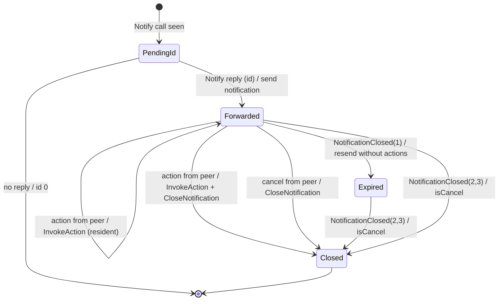

# Rich notifications

Status: implemented on `feature/richnotifications` in kdeconnect-kde and kdeconnect-android.

## Goals

- Desktop (Linux) notifications forwarded to Android carry their action buttons, and pressing a
  button on Android invokes the action in the originating desktop application.
- Dismissal is kept in sync in both directions for desktop -> Android notifications
  (Android -> desktop already had it).
- Android shows richer desktop notifications: urgency, progress, category, time, icon, and
  grouping per application.
- Android -> desktop keeps working as before. The desktop additionally shows the default action
  and urgency when the sender provides them.
- Old peers keep working in both directions without changes.

## Non-goals

- Inline reply for desktop notifications forwarded to Android (see Limitations). Android renders a
  reply field whenever a peer sends `requestReplyId`, but the desktop does not send it.
- Notification actions on desktops other than Plasma (see Limitations).
- Windows and macOS: the Windows listener forwards notifications as before, without actions.
- New packet types. Everything uses the existing `kdeconnect.notification*` packets plus optional
  fields.

## Existing behavior (verified before this work)

| Direction | Feature | State before |
|---|---|---|
| Android -> desktop | `actions` (array of labels) shown as buttons, sent back as `kdeconnect.notification.action {key, action}` | worked |
| Android -> desktop | inline reply (`requestReplyId` -> `kdeconnect.notification.reply`) | worked |
| Android -> desktop | dismissal sync both ways (`isCancel`, `request.cancel`) | worked |
| desktop -> Android | actions | parsed from D-Bus, never sent |
| desktop -> Android | dismissal | not synced either way |
| desktop -> Android | `id` | the Notify `replaces_id` (0 for every new notification), so ids collided and could not be mapped back |
| desktop -> Android | icon | always empty: `iconFromQImage()` never wrote the PNG (a `&&` that should have been `\|\|`) |
| Android ReceiveNotificationsPlugin | ignored everything except `appName`, `ticker`, `id`, `silent`, icon | - |

## Plugins and packet types

| Plugin | Receives | Sends |
|---|---|---|
| desktop `kdeconnect_sendnotifications` | `kdeconnect.notification.request`, **`kdeconnect.notification.action`** (new) | `kdeconnect.notification` |
| desktop `kdeconnect_notifications` | `kdeconnect.notification` | `kdeconnect.notification.request`, `.reply`, `.action` (unchanged) |
| Android `ReceiveNotificationsPlugin` | `kdeconnect.notification` | `kdeconnect.notification.request`, **`kdeconnect.notification.action`**, **`kdeconnect.notification.reply`** (new) |
| Android `NotificationsPlugin` | `.request`, `.reply`, `.action` (unchanged) | `kdeconnect.notification` (unchanged) |

Capability negotiation is the usual KDE Connect mechanism: each side announces these types in the
identity packet (`incomingCapabilities`/`outgoingCapabilities`) and `Device::sendPacket()` drops
packets the peer does not support. That is why both peers need the updated plugin metadata before
a button on Android can reach the desktop. If the desktop is old, the Android plugin still renders
the buttons and the action packet is dropped by the Android `Device` (logged).

On the same device both "send" and "receive" plugins handle `kdeconnect.notification.action` and
`.request`. This was already the case for the Android -> desktop direction. Each plugin only acts on
ids it knows, so a packet aimed at one plugin is a no-op in the other:
desktop `sendnotifications` only accepts keys that are numeric ids it forwarded itself, and Android
keys (`0|com.app|...`) never parse as such.

## Packet: `kdeconnect.notification` (desktop -> Android)

New optional fields are in bold. All of them may also be sent by Android in the future and are
ignored by peers that do not know them.

```json
{
  "id": "42",
  "appName": "Thunderbird",
  "title": "New message",
  "text": "Hello there",
  "ticker": "New message: Hello there",
  "isClearable": true,
  "silent": false,
  "time": "1700000000000",
  "actions": ["Archive", "Mark as read"],
  "actionIds": ["archive", "mark-read"],
  "hasDefaultAction": true,
  "resident": false,
  "urgency": 2,
  "progress": 30,
  "category": "email.arrived",
  "payloadHash": "9e107d9d372bb6826bd81d3542a419d6"
}
```

| Field | Type | Meaning |
|---|---|---|
| `id` | string | Now the id the desktop notification server assigned (from the Notify reply), stable across updates. |
| `time` | string (ms since epoch) | Same format Android already sends. |
| `actions` | string array | Labels, exactly the format Android sends. Old receivers ignore it, old desktops show it. |
| **`actionIds`** | string array | Same length and order as `actions`, the freedesktop action keys. Receivers must ignore it if the lengths differ. Never contains `default`, `inline-reply` or `settings`. |
| **`hasDefaultAction`** | bool | Tapping the notification body should invoke the `default` action. |
| **`resident`** | bool | freedesktop `resident` hint: the app keeps the notification after an action. |
| **`urgency`** | int 0-2 | freedesktop urgency: 0 low, 1 normal, 2 critical. Missing = unknown/normal. |
| **`progress`** | int 0-100 | freedesktop `value` hint (progress). |
| **`category`** | string | freedesktop category (`email.arrived`, `im.received`, `transfer.complete`, ...). |
| `payloadHash` | string | MD5 hex of the PNG icon. Always sent when there is an icon; the payload itself only when the icon changed since the previous update of the same id. |
| `silent` | bool | Now `true` for updates of a notification that was already forwarded (progress updates must not alert again) and for the resend after a `request`. |

Dismissal desktop -> Android uses the existing cancel format:

```json
{ "id": "42", "isCancel": true }
```

## Packet: `kdeconnect.notification.action`

```json
{ "key": "42", "action": "Mark as read", "actionId": "mark-read" }
```

| Field | Type | Meaning |
|---|---|---|
| `key` | string | `id` of the notification. |
| `action` | string | Label of the action. Always sent, so old receivers (matching on the label) keep working. |
| **`actionId`** | string, optional | The entry of `actionIds`, or `"default"` for the body tap. Sent only if the notification carried `actionIds`/`hasDefaultAction`. |

Receiver rule (desktop `sendnotifications`): if `actionId` is present it must be one of the
offered ids (or `default` with `hasDefaultAction`); otherwise the label is looked up in `actions`.
Anything else is ignored, so a peer can only trigger actions that were offered for a notification
that was forwarded to it.

The Android `NotificationsPlugin` keeps matching on `action` (label) and ignores `actionId`, because
Android never sends `actionIds`.

## Packet: `kdeconnect.notification.request`

Unchanged format. `{"request": true}` now also makes the desktop resend the notifications it is
tracking (with `silent: true`), and `{"cancel": "42"}` closes notification 42 on the desktop.

## Packet: `kdeconnect.notification.reply`

Unchanged: `{"requestReplyId": "...", "message": "..."}`. Android's `ReceiveNotificationsPlugin`
now sends it from a `RemoteInput` for any received notification with a non-empty `requestReplyId`.

## Desktop: how actions and dismissals actually work

The listener is not the notification server. It is a D-Bus monitor (`BecomeMonitor`) and cannot
answer method calls or own `org.freedesktop.Notifications`. Notification apps (KNotification,
libnotify, GIO) subscribe to `ActionInvoked`/`NotificationClosed` signals from the notification
server's unique name, and Plasma and GNOME Shell emit them as unicast signals to the original
caller. A third party emitting `ActionInvoked` is ignored by the apps (wrong sender), so we have to
make the server itself emit it.

What we use:

1. **Ids.** The monitor matches `Notify` method calls and `method_return` messages from
   `org.freedesktop.Notifications`, pairs them by (caller, serial) and takes the id from the reply.
   Notify calls with `NO_REPLY_EXPECTED` and `replaces_id == 0` are not forwarded (no usable id).
   Pending calls are bounded (64).
2. **Invoke.** `org.kde.NotificationManager.InvokeAction(u id, s action_key)` on
   `/org/freedesktop/Notifications`. This is the interface Plasma's notification server exports
   for its watcher clients (KDE Connect is not a registered watcher, but the method does not
   require it). The server emits `ActionInvoked(id, key)` to the app exactly as if the popup button
   was clicked. Availability is detected once per plugin instance by introspecting the server.
   After invoking, non-resident notifications are closed with `CloseNotification` (what the popup
   does too).
3. **Dismiss from the peer.** `org.freedesktop.Notifications.CloseNotification(id)`. Works on any
   compliant server (Plasma, GNOME Shell, dunst, mako, ...).
4. **Dismiss locally.** The monitor also matches `NotificationClosed` from the server. Reason 1
   (expired) means the popup timed out: Plasma keeps it in the history, so the peer keeps it but its
   buttons are removed (the app no longer handles actions for it). Reasons 2 and 3 (dismissed,
   closed by the app/server) send `isCancel` to the peer.



At most 100 forwarded notifications are tracked per device (oldest dropped). Tracking is in memory
only. After a daemon restart, notifications created earlier are unknown and cannot be acted on.

## Android: rendering

- One Android notification per remote id, tag `kdeconnectId:<deviceId>:<id>`, `setLocalOnly(true)`
  as before. The existing `kdeconnectId:` tag prefix keeps `NotificationsPlugin` from echoing it back.
- Title = `title` (fallback `appName`), text = `text` (fallback `ticker`), sub text = app name.
- Buttons: inline reply (`RemoteInput`) if `requestReplyId` is set, then one button per `actions`
  entry. Android shows at most 3 buttons, so further actions are dropped by the system UI.
- Tapping the body sends the `default` action if `hasDefaultAction`, otherwise opens KDE Connect
  (old behavior).
- Swiping away sends `request {cancel: id}` if `isClearable`. Non-clearable notifications are
  posted as ongoing.
- `urgency` 2 -> high-priority channel/`PRIORITY_HIGH`, 0 -> `PRIORITY_LOW`.
- `progress` -> determinate progress bar with only-alert-once. `time` -> `setWhen`.
- `category` is mapped to Android categories by prefix (email, im, call, transfer, network/device).
- Notifications of the same app from the same device share a group, with a summary posted once there
  are 2 or more.
- After an inline reply the notification is re-posted silently (Android otherwise shows a spinner
  forever).

PendingIntents target a non-exported `ReceiveNotificationsReceiver`. They are immutable, except the
reply intent, which must be `FLAG_MUTABLE` on API 31+ so `RemoteInput` can add the text. Each
intent has a unique data URI so buttons do not overwrite each other's extras.

## Security considerations

- Actions can only be triggered for notifications this device forwarded to that peer, and only
  with keys/labels offered in that notification. The peer cannot call arbitrary D-Bus methods,
  cannot target notifications of other apps, and cannot target notifications forwarded to a
  different device (state is per plugin instance, i.e. per device).
- Closing is limited to forwarded ids in the same way.
- Packets only flow over paired, encrypted links (existing KDE Connect guarantee).
- The existing per-app enable list, blacklist regexp, urgency threshold and "include body" settings
  still apply before anything is forwarded. Actions are forwarded with the notification, so an app
  that is not forwarded cannot be acted on.
- The D-Bus monitor now also sees `method_return` messages from the notification server and its
  `NotificationClosed` signals. It already needed monitor rights (granted to the same user on the
  session bus). Only replies to tracked Notify calls are parsed.
- The Android receiver is not exported, so other apps cannot fake button presses.
- Icon payloads are capped by the existing payload handling. The desktop scales images to at most
  256x256 before encoding.

## Platform limitations

- **Inline reply desktop -> Android is not implemented, and cannot be with public APIs.**
  The Plasma server only sends `NotificationReplied` from its own popup UI. Its watcher API
  (`WatchedNotificationsModel::reply`) is an empty `// todo` upstream, and
  `org.kde.NotificationManager` only exports `InvokeAction`. Invoking `inline-reply` through
  `InvokeAction` makes KNotification apps treat it as "reply requested without text" (they open
  their own reply UI or ignore it). A remote user would not expect that, so the desktop does not
  offer `requestReplyId`. The `inline-reply` action is filtered out (the vendored
  notificationmanager code removes it from the action list).
- **Actions only on Plasma.** GNOME Shell, dunst, mako etc. have no D-Bus method that makes the
  server emit `ActionInvoked`, and apps ignore the signal from anyone else. On those servers the
  desktop forwards notifications without `actions`/`actionIds`/`hasDefaultAction`, so Android shows
  no dead buttons. Dismissal sync (`CloseNotification`/`NotificationClosed`) works on all of them.
- Portal notifications (`org.freedesktop.portal.Notification`, used by Flatpak/GApplication when
  sandboxed) go through `xdg-desktop-portal`, which calls Notify on the server itself. They are
  forwarded and their actions invoked through the server like any other.
  [INFERENCE: not tested with a real Flatpak app.]
- Notifications posted with `NO_REPLY_EXPECTED` and no `replaces_id` are not forwarded anymore,
  because they cannot be identified. All common libraries wait for the reply.
- Notifications existing before the plugin was loaded are not forwarded (no server API lists them
  for non-watchers).
- Android: at most 3 action buttons are shown. `RemoteInput` needs API 24+ to be inline. On older
  versions Android shows its own reply screen. Grouping summaries need API 24+ to be shown as a
  bundle.
- Windows: unchanged; no actions or dismissal sync.

## UI surface

- No new settings. Rich notifications follow the existing "Send notifications" (desktop) and
  "Receive notifications" (Android) plugin toggles and their options.
- Android: action buttons, inline reply field, progress bar, priority, grouping on received
  notifications. New string: `receive_notifications_reply` ("Reply").
- Desktop: received Android notifications additionally get a default action ("Open") if the
  peer sends `hasDefaultAction`, and map `urgency` to the KNotification urgency.

## Test plan

Automated (run in CI):

- `tests/richnotificationstest.cpp` (desktop, QtTest):
  - Packet construction with actions, ids, urgency, progress, category, time and icon payload/hash.
    Serialization round trip. Plain notifications carry none of the optional fields.
  - Action resolution: by id, by legacy label, `default` only when offered, unknown ids, labels or
    notifications rejected. Store update/remove and the 100 entry bound. Key parsing rejects
    Android keys.
  - End-to-end over the loopback device with a fake Plasma-like notification server registered
    as `org.freedesktop.Notifications` on the test session bus: an app calls Notify ->
    `sendnotifications` monitor gets call and reply -> packet -> `notifications` plugin shows it with
    the right buttons -> `sendActionWithId` (new peer) and `sendAction` (legacy label) reach the
    server as `InvokeAction`, followed by `CloseNotification`. Unknown actions do not reach the
    server. Dismissing on the receiver closes it on the server. `NotificationClosed(2)` removes it
    on the receiver. `NotificationClosed(1)` (expired) keeps it but removes the actions, after which
    actions are no longer invoked.
- `ReceiveNotificationsPluginTest` (Android, Robolectric): parsing of rich and legacy packets,
  mismatched `actionIds`, clamping and invalid values, rendering (buttons, `RemoteInput`, progress,
  category, time, group, local-only, delete intent), action button -> action packet with `actionId`,
  legacy action -> label only, body tap -> `default`, inline reply -> reply packet and silent
  re-post, swipe -> cancel request, remote cancel -> removal including group summary, non-clearable
  -> ongoing, packet type declarations.
- `NotificationsPluginTest` (Android, Robolectric): action packets with and without `actionId` still
  trigger the matching Android action by label. Unknown key/label does nothing. Packet types
  unchanged.

Manual (not automated):

- Plasma 6: Thunderbird/KMail notification with buttons -> press on phone -> action runs, popup
  closes. Dismiss on phone -> gone on Plasma, and the other way round.
- GNOME: notifications arrive without buttons, dismissal syncs.
- Android 7 / 12 / 14: buttons, reply, swipe, grouping.
